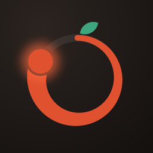

<h1 align="center">PomodoroShift</h1>

Il timer Pomodoro per studiare e lavorare concentrato. 
Gratis, senza account, senza pubblicità. Funziona offline e i tuoi dati restano sul tuo telefono.

<a href="#english">English below</a>

---

## Installa

| Telefono | Come |
|---|---|
| **Android** | Apri [Releases](https://github.com/TopLabs-HQ/PomodoroShift/releases/latest) dal telefono e scarica il file `.apk`. Aprilo e tocca **Installa**. Se Android lo chiede, consenti l'installazione da questa fonte (browser o file manager). |
| **iPhone / iPad** | Apri **[toplabs-hq.github.io/PomodoroShift](https://toplabs-hq.github.io/PomodoroShift/)** in **Safari**, tocca **Condividi** ⬆️ e poi **Aggiungi alla schermata Home**. Si apre a tutto schermo come un'app e funziona anche offline. |
| **Computer** | Apri lo stesso link in Chrome, Edge o Safari. In Chrome/Edge puoi installarla dall'icona nella barra degli indirizzi. |

Per aggiornare su Android scarica il nuovo `.apk` da Releases e installalo sopra quello vecchio: statistiche e impostazioni restano. Sul web l'app si aggiorna da sola.

## Come si usa

1. **Premi ▶︎** per iniziare 25 minuti di focus. Quando il tempo finisce il telefono **suona con la tua suoneria di notifica e vibra**, anche se l'app è chiusa o lo schermo è bloccato.
2. **Fai la pausa.** Dopo ogni focus arriva una pausa breve; ogni 4 focus, una pausa lunga. I pallini in alto mostrano a che punto sei del ciclo.
3. **Trascina l'anello** prima di iniziare per scegliere i minuti al volo (da 1 a 180), oppure tocca il nome della fase per passare a pausa breve o lunga.
4. **Tieni premuto "Azzera"** per ricominciare la fase, tocca ⏭ per saltarla.

Sotto il timer vedi i focus fatti oggi rispetto al tuo obiettivo, la tua serie di giorni 🔥 e il "flow", cioè quanti focus hai completato di fila senza saltarne.

### Statistiche

Minuti di focus di oggi, della settimana, del mese e dell'anno, la serie attuale e quella record, il grafico giorno per giorno e una mappa di attività degli ultimi 12 mesi. Tieni premuto un giorno della mappa per i dettagli.

### Personalizza tutto

| Impostazioni › | Cosa puoi cambiare |
|---|---|
| **Timer** | Durata di focus, pausa breve e lunga · ogni quanti focus arriva la pausa lunga · avvio automatico di pause e focus · obiettivo giornaliero · ora in cui inizia il giorno (per chi studia di notte) · preset: Classico 25/5/15, Studio 45/10/20, Deep work 50/10/30, Sprint 15/3/10 |
| **Temi** | 6 temi, ognuno chiaro e scuro: Pomodoro, Mezzanotte, Carta, Terminale, Sakura, Evidenziatore · movimento completo o ridotto |
| **Suoni e aptica** | Suoneria del telefono o suoni dell'app · vibrazione · ticchettio durante il focus · schermo sempre acceso |
| **Notifiche** | Avviso a fine fase · conto alla rovescia nella barra delle notifiche (Android) |
| **Lingua** | Italiano o English |
| **Dati** | Esporta e importa un backup (file JSON) · cancella tutto · rivedi l'introduzione |

**Modalità zen:** durante il focus i comandi spariscono dopo pochi secondi. Tocca lo schermo per farli tornare.

### Per sviluppatori

- Tema **Terminale** con prompt `> focus_` e barra di avanzamento ASCII.
- **Link rapidi** da usare con Comandi rapidi (iOS) o Tasker (Android): `pomodoro://start?min=25`, `pomodoro://pause`, `pomodoro://skip`, `pomodoro://stats`, `pomodoro://theme/terminal`.
- **Scorciatoie da tastiera** nella versione web: `Spazio` avvia/pausa, `S` salta, `R` azzera, `1` `2` `3` scelgono la fase, `T` cambia tema.
- **Backup JSON** dei tuoi dati, con un formato leggibile.

## Privacy

Niente account, niente server, niente tracciamento. Sessioni, statistiche e impostazioni sono salvate solo sul tuo dispositivo. L'app non usa internet: online serve solo a scaricarla.

## Limiti da sapere

- **iPhone (versione web):** Safari non permette alle app web di suonare o mandare notifiche quando sono chiuse. Il suono di fine fase arriva solo se l'app è aperta sullo schermo, e su iPhone il web non può far vibrare.
- **Android:** alcuni telefoni con risparmio energetico aggressivo possono ritardare l'avviso di qualche secondo. Il tempo mostrato resta sempre esatto.

---

## English

**PomodoroShift** is a free Pomodoro timer with no account, no ads and no tracking. It works offline, and your data stays on your device.

### Install

| Device | How |
|---|---|
| **Android** | Open [Releases](https://github.com/TopLabs-HQ/PomodoroShift/releases/latest) on your phone, download the `.apk`, open it and tap **Install**. Allow installs from that source if Android asks. |
| **iPhone / iPad** | Open **[toplabs-hq.github.io/PomodoroShift](https://toplabs-hq.github.io/PomodoroShift/)** in **Safari**, tap **Share** ⬆️ → **Add to Home Screen**. It runs full screen and works offline. |
| **Computer** | Open the same link in Chrome, Edge or Safari. |

To update on Android, install the new `.apk` over the old one; your stats and settings stay.

### Use it

1. **Tap ▶︎** to start a 25-minute focus. When it ends, your phone **rings with your notification sound and vibrates**, even if the app is closed.
2. **Take the break.** A short break follows each focus, and a long break every 4 focus sessions.
3. **Drag the ring** before starting to pick 1–180 minutes, or tap the phase name to switch phase.
4. **Hold "Reset"** to restart the phase; tap ⏭ to skip it.

**Stats** show today, week, month and year, your streak and a 12-month activity map. **Settings** let you change every duration, the daily goal, when your day starts, 6 themes (light and dark), sounds, vibration, notifications, language (Italian/English) and JSON backups. Developers get a Terminal theme, deep links (`pomodoro://start?min=25`, `pause`, `skip`, `stats`, `theme/terminal`) and keyboard shortcuts on web (`Space`, `S`, `R`, `1` `2` `3`, `T`).

**Limits:** on iPhone (web version) Safari can't play sounds or show notifications while the app is closed, and it can't vibrate.

---

© 2026 TopLabs HQ · Free to use, not to copy: see <a href="LICENSE">LICENSE</a>.

